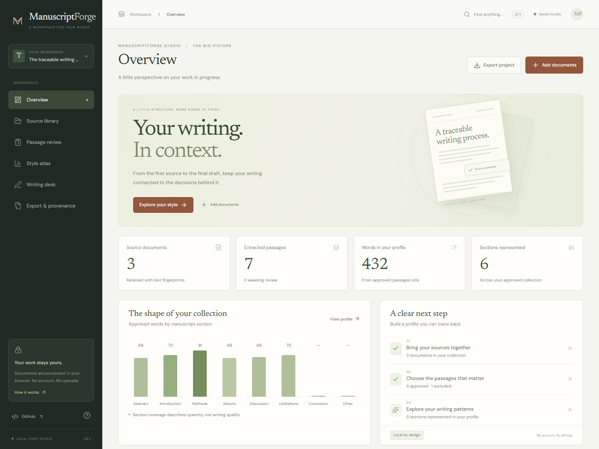
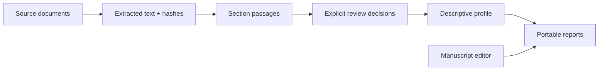

# ManuscriptForge

### A considered workspace for research writing.

Turn writing samples into a reviewed corpus, explore the patterns in your prose, and work on a manuscript with its sources close at hand. ManuscriptForge pairs an interactive browser studio with a local Python toolkit for traceable document analysis.

[](https://github.com/ericrosenn1/manuscriptforge/actions/workflows/ci.yml)
[](https://github.com/ericrosenn1/manuscriptforge/actions/workflows/studio.yml)
[](docs/studio.md#privacy-and-storage)



**[Studio guide](docs/studio.md)** · **[Python walkthrough](docs/demo.md)** · **[Architecture](docs/architecture.md)** · **[Development](docs/development.md)**

## Start the studio

The studio runs entirely in your browser. You can explore the bundled synthetic collection immediately, or start an empty workspace and import your own documents. No account, Python server, API key, or model download is required.

With Git and Node.js 24 installed:

```bash
git clone https://github.com/ericrosenn1/manuscriptforge.git
cd manuscriptforge
npm ci --prefix web
npm run dev --prefix web
```

Open the local address printed in the terminal. The [studio guide](docs/studio.md) covers the complete workflow and production builds.

## From source documents to an intentional draft

| Workspace | What you can do |
| --- | --- |
| **Overview** | See corpus size, review status, section coverage, and the next useful step. All metrics are computed from your current workspace. |
| **Source library** | Import Markdown, plain text, DOCX, and text-based PDF files. Inspect extracted text and SHA-256 source identifiers. |
| **Passage review** | Filter passages, approve or exclude them, and record the reasoning behind a decision. Only approved passages contribute to the profile. |
| **Style profile** | Explore sentence lengths, recurring terms, section balance, and rule-based linguistic indicators. |
| **Manuscript** | Write and revise in Markdown, preview the document, and export a Markdown or DOCX copy. |
| **Exports** | Download a portable ZIP with the workspace, extracted source text, review decisions, analysis, manuscript, and a checksum manifest. Reopen the workspace from its JSON file. |

The studio saves changes to this browser on this device. Download a workspace export when you need a backup or want to move between devices.

## A demo with inspectable provenance

The bundled collection uses original, explicitly synthetic passages about an imagined distance-sensor documentation procedure. Its three documents produce seven passages: six approved sections and one excluded duplicate. You can change any decision and watch the profile respond.

These are the same source passages used by the Python demo. The browser and Python engines have separate implementations; their tokenization, extraction, and descriptive metrics are not asserted to be numerically identical. The demo represents no physical experiment, real results, or actual author profile.

## The Python toolkit

The existing Python workflow remains available for local file processing, reviewed passage registries, section profiles, and reproducible reports. Use Python 3.11, 3.12, or 3.13.

Windows PowerShell:

```powershell
py -3.12 -m venv .venv
.\.venv\Scripts\python.exe -m pip install .
.\.venv\Scripts\manuscriptforge.exe demo ..\manuscriptforge-demo
```

Linux or macOS:

```bash
python3 -m venv .venv
source .venv/bin/activate
python -m pip install .
manuscriptforge demo ../manuscriptforge-demo
```

Open the generated `DEMO_REPORT.md`. It links to the style guide, passage review, coverage report, and style cards. The demo checks its outputs and verifies an unchanged completed run when invoked again. Installation downloads dependencies; the demo itself runs offline.

For your own documents, follow the [usage guide](docs/usage.md). Additional Python components support experimental claim and citation records, drafting, audits, feedback, and manuscript exports; see their [documented scope](docs/architecture.md#experimental-manuscript-path).

## Design and engineering



- **Inspectable data:** source identifiers, content hashes, passage decisions, and exports make the analysis traceable.
- **Explicit selection:** pending and excluded passages remain visible while staying out of the browser profile.
- **Portable state:** versioned JSON and an archive of readable files avoid a service dependency.
- **Separate engines:** the TypeScript studio runs in the browser; the Python toolkit runs against local project folders. Neither quietly invokes the other.
- **Tested workflows:** unit tests cover selection, analysis, import validation, and exports; browser tests cover real interactions. The existing Python test suite remains intact.

## Boundaries

ManuscriptForge describes writing samples; it does not grade writing quality, validate scientific claims, learn an author's identity, or generate new research. Sentence boundaries, section recognition, and linguistic indicators use rules. Sparse samples should be interpreted cautiously.

PDF import requires a text layer and does not perform OCR. Document extraction does not preserve every layout, annotation, or tracked change. Browser storage is not encrypted and can be cleared by the browser. Exports contain the supplied prose and should be reviewed before sharing.

The browser app has no analytics or server upload path. Hosting still serves application assets; external links open only when you follow them. The Python toolkit's optional network-capable providers require separate configuration.

## Project and attribution

Created by **Eric H. Rosenn**, with AI coding assistance. Citation metadata is in [CITATION.cff](CITATION.cff). This is research software with a usable browser workflow, not a scientifically validated author-modeling system.

**License not yet specified.** No project-wide reuse license is granted here. Dependency licenses and applicable third-party notices remain with their respective materials.
