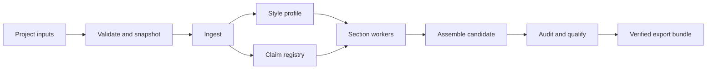

# ManuscriptForge

### Research writing with an inspectable chain of evidence.

ManuscriptForge is a Python research-writing engine with reproducible execution, source-linked drafts, local retrieval, and a trainable style-preference ranker. It keeps inputs, evidence, author decisions, candidate prose, and validation results distinct.

[](https://github.com/ericrosenn1/manuscriptforge/actions/workflows/ci.yml)
[](https://github.com/ericrosenn1/manuscriptforge/actions/workflows/studio.yml)

**[Research workflow](docs/research-workflow.md)** · **[Evaluation](docs/evaluation.md)** · **[0.2.0 release notes](docs/release-0.2.0.md)** · **[Architecture](docs/architecture.md)** · **[Optional Studio](docs/studio.md)**

## What it does

| Capability | Implemented behavior |
| --- | --- |
| Reproducible execution | A trusted dependency graph runs isolated stages with durable state, bounded retries, cancellation, content-addressed reuse, and hash verification. |
| Document and evidence intake | Reads local text, Markdown, DOCX, text-based PDFs, tables, and citation records. Source hashes and locations accompany extracted material. |
| Grounded candidate drafting | A typed model boundary checks source IDs, claim linkage, numerical consistency, citation identifiers, style-only copying, and output limits. Rejected output cannot silently become an accepted section. |
| Local retrieval | Inspectable BM25 or Jaccard ranking, metadata filters, optional diversity selection, and validated serialized indexes. |
| Learned style preferences | A NumPy logistic ranker learns from explicit labeled passage pairs. It uses stylometric features, grouped holdouts, and train-only scaling; ranking leaves text unchanged. |
| Evaluation and handoff | Paired held-out functional tests, abstention and calibration measurements, latency/usage records, immutable artifacts, and a verified manuscript bundle. |



A successful run means the computational workflow completed. It does **not** establish scientific truth, semantic entailment, publishable writing quality, or faithful imitation of an author.

## Start locally

Use Python 3.11–3.13 and Git. Install from the repository in a virtual environment:

```bash
git clone https://github.com/ericrosenn1/manuscriptforge.git
cd manuscriptforge
python -m venv .venv
# Activate .venv using your shell, then:
python -m pip install -e ".[dev]"
python -m manuscriptforge.cli research demo ../manuscriptforge-demo --no-run
python -m manuscriptforge.cli research plan ../manuscriptforge-demo
python -m manuscriptforge.cli research run ../manuscriptforge-demo --provider mock
```

In Windows PowerShell, use `.\.venv\Scripts\python.exe` in place of `python` without activating the environment. The demo is an original synthetic nonmedical project; its draft and audit findings are for inspection, not scientific acceptance. No API key is required for the mock workflow.

Use the run ID printed by `research run`:

```bash
manuscriptforge research status ../manuscriptforge-demo RUN_ID
manuscriptforge research verify ../manuscriptforge-demo RUN_ID
manuscriptforge research resume ../manuscriptforge-demo RUN_ID
```

The [research guide](docs/research-workflow.md) covers inputs, resume, cancellation, artifacts, model access, and budgets. The original `manuscriptforge demo NEW_DIR` command remains available for the smaller writing-corpus walkthrough.

## Evidence and limits

The evaluation suite preserves negative and inconclusive results rather than treating generated files as proof of model quality.

| Check | Observed scope | Interpretation |
| --- | --- | --- |
| Adversarial regression probes | The pinned pre-campaign source passed 0/11 selected invariants; the repaired implementation passed 11/11. | Targeted software corrections, not a language-model quality score. The [reproducible probe script](scripts/benchmark_invariants.py) runs against either source tree. |
| Basic source-only model comparison | Luna and Sol each passed 48/48 synthetic development cases; paired difference 0. | Source-quote, tuple and abstention checks across six independent families. Development-set evidence, not scientific validation. |
| Synthetic source retrieval | BM25 and Jaccard showed no relevance difference on the controlled held-out collection. | A null relevance finding is retained. Timing is specific to the synthetic fixture and hardware. |
| Learned preference mechanism | 24/24 held-out synthetic pairs versus 11/24 for the training-majority baseline, across six held-out document groups. | Labels come from a disclosed latent rule. This does not establish real-author efficacy. |
| Model-generated prose | Structured source checks and explicit review flags. | Factual entailment, scientific conclusions, and author preference require separate validation. |

The [release notes](docs/release-0.2.0.md) separate model results, local workflow timings, lexical speed measurements, and the dated budget snapshot. See the [evaluation protocol](docs/evaluation.md) and [learning model notes](docs/learning.md). Legacy style scores are labeled diagnostic; absent evidence produces null or inconclusive results. No universal writing-quality or hallucination-free claim is made.

## Data and model access

Local workflows are the default. Optional paid model calls require explicit network permission, a configured provider, and a shared budget ledger. Input snapshots and exported reports may contain source prose: review them before sharing. Source documents are treated as data, not executable instructions.

Install the optional provider with `python -m pip install -e ".[openai]"` before using it.

The [research guide](docs/research-workflow.md) explains the budget gate, records, and privacy boundary. API keys belong in the local environment or an ignored `.env` file, never in commands, reports, or committed source.

## Optional browser Studio

The separate browser interface offers source inspection, passage review, descriptive charts, manuscript editing, and portable exports. It runs locally without a Python server or API key; it does not invoke the research engine automatically.

```bash
npm ci --prefix web
npm run dev --prefix web
```

<details>
<summary>See the browser workspace</summary>


</details>

[Studio guide](docs/studio.md) · [Python corpus walkthrough](docs/demo.md) · [Development and validation](docs/development.md)

## Author and citation

Created by **Eric H. Rosenn**, with AI coding assistance. Citation metadata is in [CITATION.cff](CITATION.cff).

**License not yet specified.** No project-wide reuse license is granted here. Dependency licenses and applicable third-party notices remain with their respective materials.
