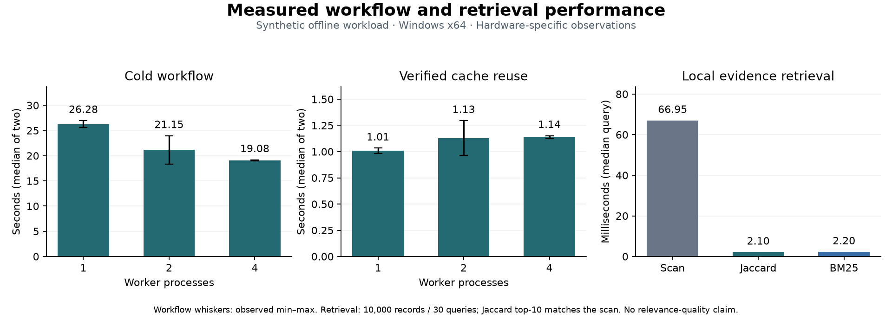

# 0.2.0: research engine

Version 0.2.0 adds an inspectable research-writing workflow around the existing corpus tools. It supports resumable execution, source-linked candidate drafting, lexical retrieval, explicit preference learning, and versioned evaluation. The browser Studio remains a separate optional interface.

## Implemented changes

- A trusted dependency graph with isolated workers, bounded retries, cancellation, input snapshots, hash-verified cache reuse, and immutable finalized bundles.
- Typed generation and extraction boundaries with quote anchors, source hashes, citation membership, quantitative relation checks, and human-review status.
- [Author claim review](claim-review.md) with source-bound approvals/rejections, stale-decision detection, and explicit section routing. The synthetic v2 demo supplies labeled review fixtures; ordinary projects receive no automatic approvals.
- Cited-only manuscript bibliographies, with unused input citation records preserved in ingestion artifacts.
- A shared budget ledger for optional model calls, recording measured usage and conservative reservations separately.
- BM25 and indexed Jaccard retrieval, metadata filters, optional diversity selection, and validated JSON indexes.
- A trained NumPy logistic preference ranker using explicit labels, grouped splits, training-only scaling, calibration, and portable checksummed JSON.
- Grouped paired evaluation with withheld labels, versioned scoring, null denominators, source provenance, latency/cost records, and optional local raw-response diagnostics.

## Measured evidence

These are different experiments with different endpoints. They must not be combined into one quality score.

The [benchmark evidence package](https://github.com/ericrosenn1/manuscriptforge/tree/main/benchmarks/2026-10-31) contains original reports and downloadable archives, alongside [verification results](https://github.com/ericrosenn1/manuscriptforge/blob/main/benchmarks/2026-10-31/verification.json). Each measurement identifies its source snapshot and workload; older and newer runs are kept separate.

The full local runtime checkpoint passed **592 tests**, with one Windows symlink-privilege skip and **86% line coverage including worker subprocesses**. Four stricter CLI argument checks subsequently passed independently. Fresh wheel installation exercised the complete offline workflow outside the checkout. Final-commit CI records are the authority for the complete platform matrix.

The [model-backed reviewed demo](https://github.com/ericrosenn1/manuscriptforge/blob/main/benchmarks/2026-10-31/evidence/paid-reviewed-demo.summary.json) completed all 14 nodes and all seven manuscript sections with unchanged inputs and a verified bundle. Its approvals are explicitly scripted fixture labels; they are not human scientific validation.

| Experiment | Observed result | What it supports |
| --- | --- | --- |
| [Selected adversarial invariants](https://github.com/ericrosenn1/manuscriptforge/blob/main/benchmarks/2026-10-31/evidence/engine-invariants.summary.json) | Pinned pre-campaign implementation: 0/11; repaired implementation: 11/11. | Eleven targeted software corrections, not general model reliability. |
| [Basic source-only development set](https://github.com/ericrosenn1/manuscriptforge/blob/main/benchmarks/2026-10-31/evidence/source-only-dev.summary.json) | `gpt-6-luna:low` and `gpt-6.1-sol:low` each passed 48/48 cases; paired difference 0. Each produced 36 responsive facts and correctly withheld answers in 12 cases. | Synthetic tuple, source-quote, and abstention consistency across six independent families. This is development data, not final held-out scientific validation. |
| [Learned preference mechanism](https://github.com/ericrosenn1/manuscriptforge/blob/main/benchmarks/2026-10-31/evidence/style-learning.summary.json) | 24/24 held-out synthetic pairs versus 11/24 for the training-majority baseline, across six document groups. | Learning and evaluation work on a disclosed synthetic labeling rule; real-author efficacy is unmeasured. |
| Synthetic lexical relevance | No difference between BM25 and Jaccard in the controlled held-out comparison. | A retained null relevance result. Speed and relevance are separate endpoints. |
| [Indexed Jaccard timing](https://github.com/ericrosenn1/manuscriptforge/blob/main/benchmarks/2026-10-31/evidence/retrieval-performance-v2.json) | About 70 ms to 2.23 ms median per query on 10,000 synthetic records and 30 queries, with identical top-10 rankings. | Faster execution of that exact lexical ranking on the measured machine, not improved retrieval quality. |

The basic source-only experiment used protocol `2.0-source-only`. Its standard-rate token cost estimates were USD 0.0066794 for Luna and USD 0.111098 for Sol; these are estimates rather than invoices. The conservative cumulative campaign-budget snapshot immediately before the subsequent quantity development experiment was USD 0.62693575. This is a dated spending snapshot, not the final campaign total.

## Workflow timing

The following medians come from the [reviewed fixture v2 workflow](https://github.com/ericrosenn1/manuscriptforge/blob/main/benchmarks/2026-10-31/evidence/workflow-performance-v2.summary.json), using the mock provider on Windows 11 / Python 3.13.15. There were two repetitions per configuration; all 12 runs passed artifact verification.

| Workers | Cold workflow (seconds) | Verified warm-cache workflow (seconds) |
| ---: | ---: | ---: |
| 1 | 26.277 | 1.008 |
| 2 | 21.147 | 1.130 |
| 4 | 19.076 | 1.139 |

This measures local orchestration and I/O. Cold means an empty application cache, not a cold operating-system cache. It does not measure live-model latency or represent every project. Two repetitions are insufficient for a broad performance claim. The [earlier fixture timings](https://github.com/ericrosenn1/manuscriptforge/blob/main/benchmarks/2026-10-31/evidence/workflow-performance-v1.summary.json) remain available without treating different fixtures as a controlled speed comparison.

## Quantity evaluation and compatibility

The [quantity dataset](quantity-benchmark.md) contains 420 cases in 14 strata across 30 independent document/author families. The original v1 experiment remains an invalid-contract diagnostic. Revision v1.1 clarifies the query without changing sources, gold facts, partitions or scoring endpoints.

| Quantity v1.1 split | Luna complete cases | Sol complete cases |
| --- | ---: | ---: |
| [Development](https://github.com/ericrosenn1/manuscriptforge/blob/main/benchmarks/2026-10-31/evidence/quantity-v11-dev.summary.json) | 84/84 | 84/84 |
| [Locked test](https://github.com/ericrosenn1/manuscriptforge/blob/main/benchmarks/2026-10-31/evidence/quantity-v11-test.summary.json) | 83/84 | 84/84 |

The [recorded selection lock](https://github.com/ericrosenn1/manuscriptforge/blob/main/benchmarks/2026-10-31/evidence/quantity-v11-selection.summary.json) chose Luna before opening test results, using the lower measured token cost to break the development tie: USD 0.0130264 versus USD 0.237178. That selection remains unchanged after test. The report's `baseline` and `candidate` fields identify Luna and Sol respectively; they do not imply a ranking of model quality.

The single Luna test failure dropped a negative sign and was rejected by source validation. No incorrect tuple was accepted in this test set. The observed Sol-minus-Luna complete-case difference is 1.19 percentage points, with a paired group-bootstrap 95% interval of 0–3.57 points. There are only six independent test families; the 84 cases are correlated. This does not establish model superiority or generalization to natural research documents.

Scoring `2.1-quantities` adds explicit whole-scalar numerical equivalence for Unicode/spaced signs. Extraction guard and scoring versions are recorded separately. Existing `2.0-source-only` reports and dataset labels remain unchanged. Legacy style scores are diagnostic or inconclusive when evidence is absent; they are not universal quality ratings.

Python 3.11–3.13 is supported. The original corpus CLI remains available. Optional paid-provider use requires the `openai` extra and explicit network/budget configuration. Raw-response capture defaults to off and writes only local evaluation artifacts when enabled.

See the [workflow](research-workflow.md), [evaluation protocol](evaluation.md), and [development checks](development.md) for reproducibility and interpretation limits.
