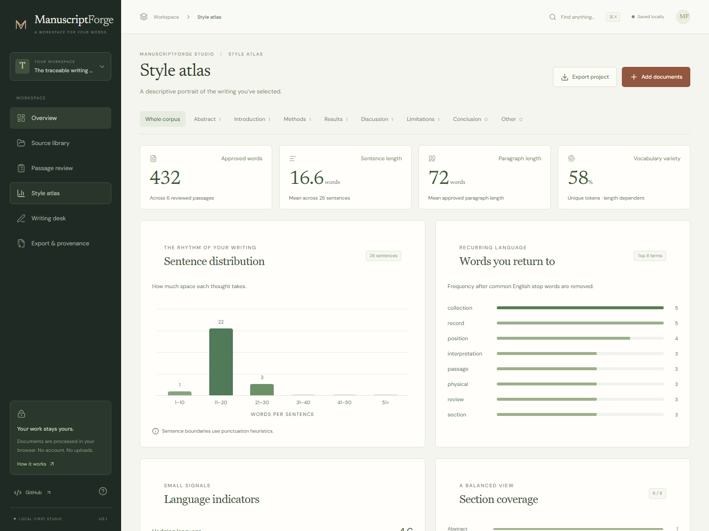

# ManuscriptForge Studio

The studio is a browser workspace for reviewing a writing collection, inspecting descriptive patterns, and editing a manuscript. Its local TypeScript engine works without the Python toolkit or an external model service.


## Run locally

Install Node.js 24, then run from the repository root:

```bash
npm ci --prefix web
npm run dev --prefix web
```

Open the local address printed by Vite. A first visit opens the synthetic demo. The app's navigation separates the overview, sources, passage review, profile, manuscript, and exports.

## Review the demo

1. Inspect the overview and its counts.
2. Open the source library to read the three original synthetic documents.
3. Review the passages. Six are approved; a repeated methods passage is excluded.
4. Change an approval and return to the profile. Counts and distributions recompute from approved passages only.
5. Open the manuscript editor, edit the sample text, and compare the preview.
6. Download a workspace archive to inspect the text, decisions, analysis, and checksums.

The demo documents an imagined distance-sensor workflow. It contains no real experiment, sensor measurements, real author profile, or externally sourced scientific claims. Its source prose matches `manuscriptforge/demo.py`; the browser and Python analyses are independently implemented.

## Import a writing collection

Create a new workspace and import supported files from the source library:

| Format | Extraction |
| --- | --- |
| `.md`, `.txt` | UTF-8 text; common section headings identify passages. |
| `.docx` | Local extraction of Word document text. Original Word layout and revision semantics are not retained. |
| `.pdf` | Local extraction from the PDF text layer. Scanned documents require OCR outside this app. |

New passages start pending review. Approve material you want to include, exclude material that does not belong, and retain a short note when the decision needs explanation. References and bibliography sections are left out of profile passages.

Import errors do not imply that a document has no relevant content. The app reports unsupported, oversized, unreadable, or textless files; correct the input and retry. File sizes and PDF page counts are bounded to keep browser processing manageable.

## Understand the profile



The profile reflects **approved passages only**. Pending and excluded passages remain available for inspection but do not contribute to descriptive metrics.

Sentence lengths, recurring terms, section distribution, lexical diversity, hedging, and passive-voice indicators are rule-based summaries. They depend on the selected source text and may misclassify unfamiliar structures. They do not establish writing quality, scientific validity, representativeness, or successful imitation of an author's voice.

An empty approved collection produces an empty profile. The interface does not invent values to fill missing sections.

## Write and export

The manuscript editor is for author-supplied Markdown. It does not generate prose, citations, or results. Use the preview to inspect headings and paragraph structure, then download Markdown or DOCX.

The workspace archive includes a versioned project JSON, extracted source text, passage decisions, descriptive analysis, a manuscript copy, and a checksum manifest. JSON import reopens the portable workspace; an archive must first be extracted to access its project JSON. Imported data is validated before it replaces the current workspace.

Source hashes identify the bytes or normalized text recorded by the browser workflow; inspect the manifest and source metadata for their context. They prove correspondence within the export, not the truth of a document's contents.

## Privacy and storage

Imported documents are processed in the browser. The studio does not send their content to a server or model provider and has no analytics integration. Application files are downloaded from the host, and following an external link contacts its destination normally.

Workspace state is stored in this browser's local storage on this device and origin. It is not encrypted, automatically synchronized, or a substitute for a backup. A different host or port has separate storage; clearing browser data can remove the workspace. Export before changing devices, using a shared machine, clearing browser data, or replacing a collection you want to retain.

The archive can contain your full extracted prose and review notes. Inspect it before sharing. This storage model is intended for individual, local use; it is not a multi-user access-control system.

## Production build and publication

```bash
npm run build --prefix web
npm run preview --prefix web
```

The build writes static assets to `web/dist`. No database or application server is required. Set Vite's base path when serving from a subdirectory:

```bash
npm run build --prefix web -- --base=/manuscriptforge/studio/
```

The repository's existing GitHub Pages workflow is configured to publish the studio under `/manuscriptforge/studio/` alongside the documentation after changes reach `main`. A successful local build does not establish that a version is published. Verify the actual deployment before sharing a live link.

## Development checks

```bash
npm test --prefix web
npm run build --prefix web
cd web
npx playwright install chromium
npm run test:e2e
```

Unit tests exercise the analysis and portable file contracts. Browser tests exercise the interface in Chromium. Python validation remains separate; see [Development](development.md).
